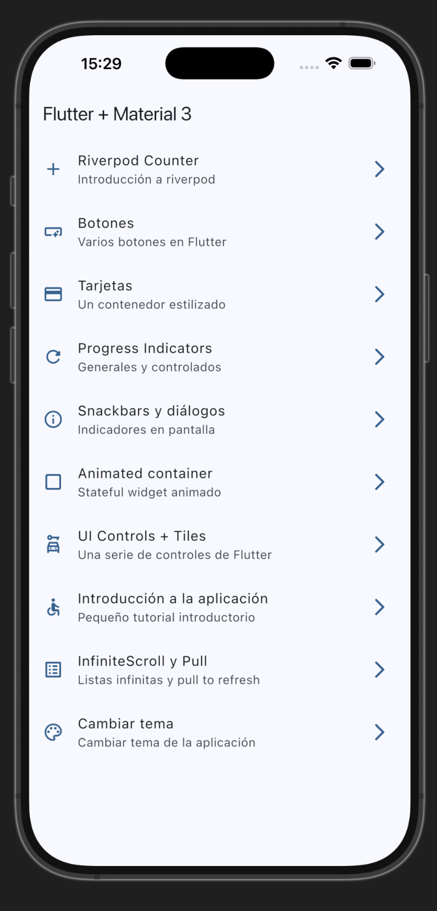

# Widgets App · Catálogo de widgets con Flutter

<p align="center">
  <strong>Explora, cambia el tema y prueba cada widget.</strong><br>
  Flutter · Material 3 · go_router · Riverpod
</p>

<p align="center">
  <a href="https://fariasdgs.github.io/Practicas_DMI_230389/practica05/">
    
  </a>
  <a href="https://fariasdgs.github.io/Practicas_DMI_230389/practica05/arquitectura.html">
    
  </a>
</p>

<p align="center">
  <a href="#capturas-de-la-aplicación">Ver capturas</a> ·
  <a href="#funcionalidades">Funcionalidades</a> ·
  <a href="#instalación-y-ejecución">Ejecutar la app</a> ·
  <a href="#verificación">Verificación</a>
</p>

<p align="center">
  
</p>

Proyecto de la **Práctica 05: Widgets App**, desarrollado por **Al Farias Leyva · 230389** para la asignatura **Desarrollo Móvil Integral**.

## Modelo interactivo del proyecto

- [Modelo de la aplicación](https://fariasdgs.github.io/Practicas_DMI_230389/practica05/): recorrido desde el Home y el menú hasta cada grupo de pantallas.
- [Diagrama de arquitectura](https://fariasdgs.github.io/Practicas_DMI_230389/practica05/arquitectura.html): inicio, navegación, pantallas, estado local, Riverpod, tema e imágenes en red.

Ambos son archivos HTML autónomos: permiten cambiar entre tema claro y oscuro, ampliar, buscar y exportar. También puedes abrirlos sin conexión: [modelo local](../../docs/practica05/index.html) y [arquitectura local](../../docs/practica05/arquitectura.html). Las especificaciones editables y los recibos de validación están en [docs/archify](docs/archify/).

El diagrama de arquitectura refleja el código actual. En el modelo, las flechas siguen el orden del recorrido por los grupos del menú; no representan llamadas entre pantallas.

## Capturas de la aplicación

Evidencia de Widgets App ejecutándose en el **simulador de iPhone**. El Home lista las diez pantallas del catálogo con su ícono, título y subtítulo, y cada fila abre su pantalla con `go_router`.

<table>
  <tr><th align="center">Home</th></tr>
  <tr>
    <td align="center" valign="top">
      <br>
      <sub>Las diez opciones del catálogo en Material 3.</sub>
    </td>
  </tr>
</table>

## Descripción

Widgets App es un catálogo de componentes de Flutter. El **Home** lista las pantallas de demostración y el **menú lateral** permite abrirlas desde cualquier punto. Cada pantalla practica un widget o una técnica: botones, tarjetas, indicadores de progreso, diálogos, controles, animaciones, scroll infinito y gestión de estado con Riverpod.

La aplicación usa **Material 3**. El color y el modo oscuro se cambian en tiempo real y afectan a toda la app.

## Objetivo

Conocer y reutilizar los widgets más comunes de Flutter, navegar entre pantallas con `go_router` y administrar el estado global con `flutter_riverpod`.

### Objetivos específicos

- Navegar por nombre y por ruta con `GoRouter`.
- Construir un menú a partir de una lista de `MenuItem` y mostrarlo en el Home y en un `NavigationDrawer`.
- Aplicar los distintos tipos de botones, tarjetas e indicadores de progreso de Material 3.
- Mostrar `SnackBar`, `AlertDialog` y `showAboutDialog`.
- Combinar `Switch`, `Radio` y `Checkbox` en listas (`ListTile`).
- Animar propiedades con `AnimatedContainer` y entradas con `animate_do`.
- Cargar más elementos al llegar al final de una lista y refrescarla con *pull to refresh*.
- Administrar un contador y el tema con Riverpod (`StateProvider` y `StateNotifier`).

## Funcionalidades

| Pantalla | Ruta | Qué muestra |
| --- | --- | --- |
| Riverpod Counter | `/counter-river` | Contador inicial en 5 con `StateProvider` y botón para alternar el modo oscuro |
| Botones | `/buttons` | `Elevated`, `Filled`, `Outlined`, `Text`, `IconButton` y un botón personalizado |
| Tarjetas | `/cards` | Cuatro estilos de `Card` con distintas elevaciones |
| Progress Indicators | `/progress` | Indicadores circulares y lineales, generales y controlados |
| Snackbars y diálogos | `/snackbars` | `SnackBar` con acción, `AlertDialog` y diálogo «Acerca de» |
| Animated container | `/animated` | Tamaño, color y bordes aleatorios con animación |
| UI Controls + Tiles | `/ui-controls` | `SwitchListTile`, `RadioListTile` y `CheckboxListTile` |
| Introducción a la aplicación | `/tutorial` | Tutorial de tres páginas con `PageView` y animaciones |
| InfiniteScroll y Pull | `/infinite` | Lista que añade imágenes al llegar al final y se refresca al deslizar |
| Cambiar tema | `/theme-changer` | Selector de nueve colores y modo claro u oscuro |

Los diez accesos se muestran en el Home y en el menú lateral. El menú separa **Main** (las tres primeras opciones) y **More options** (el resto).

## Organización del proyecto

```text
Practica05/widgets_app/
├── lib/
│   ├── main.dart                         # ProviderScope y MaterialApp.router
│   ├── config/
│   │   ├── menu/menu_items.dart          # Lista de opciones del menú
│   │   ├── router/app_router.dart        # Rutas de go_router
│   │   └── theme/app.theme.dart          # AppTheme y colorList
│   └── presentation/
│       ├── providers/                    # counter_provider y theme_provider
│       ├── screens/                      # Una carpeta por pantalla
│       └── widgets/side_menu.dart        # NavigationDrawer
├── test/widget_test.dart
├── docs/archify/                         # Fuente editable de los diagramas
└── README.md

../../docs/practica05/                    # Diagramas HTML para GitHub Pages
```

| Componente | Responsabilidad |
| --- | --- |
| `MainApp` | Observa `themeNotifierProvider` y configura `MaterialApp.router` |
| `appRouter` | Declara las once rutas, cada una con su nombre |
| `appMenuItems` | Fuente única de títulos, subtítulos, rutas e íconos del menú |
| `SideMenu` | `NavigationDrawer` que navega con `context.push` |
| `counterProvider` | Valor del contador, con 5 como estado inicial |
| `ThemeNotifier` | Alterna el modo oscuro y cambia el color del tema |
| `AppTheme` | Genera el `ThemeData` Material 3 con color semilla |

## Tecnologías

| Tecnología | Uso |
| --- | --- |
| Flutter y Dart | Interfaz y widgets de Material 3 |
| `go_router` | Navegación declarativa |
| `flutter_riverpod` | Estado global del contador y del tema |
| `animate_do` | Animaciones de entrada del tutorial |
| Archify | Modelo y arquitectura interactivos en HTML |

## Instalación y ejecución

Requiere Flutter con Dart compatible con `^3.13.2` y un emulador o dispositivo configurado. Desde la raíz del repositorio:

```bash
cd Practica05/widgets_app
flutter pub get
flutter devices
flutter run
```

Selecciona el dispositivo cuando Flutter lo solicite, o usa `flutter run -d ID_DEL_DISPOSITIVO`.

## Verificación

```bash
flutter analyze
flutter test
```

Las pruebas cubren tres casos: el contador pasa de 5 a 6 y el ícono cambia el tema a oscuro, el tutorial abre aunque falten las imágenes, y el cambio de color y de modo se refleja en toda la aplicación.

Verificación manual:

1. Abre el Home y confirma las diez opciones.
2. Abre el menú lateral desde el ícono de hamburguesa y entra a una pantalla.
3. En Riverpod Counter, incrementa el valor y alterna el modo oscuro.
4. En Cambiar tema, elige otro color y comprueba que cambia toda la app.
5. En InfiniteScroll, llega al final de la lista y desliza hacia abajo para refrescar.

## Alcance y pendientes

- La carpeta `assets/images` no existe y `pubspec.yaml` no declara assets. El tutorial y el indicador de carga usan imágenes de ese directorio; sin ellas se muestran íconos de respaldo (lo cubre una prueba).
- El scroll infinito carga imágenes de `picsum.photos`, por lo que necesita conexión.
- El tema y el contador viven en memoria: se reinician al cerrar la app.
- La captura del Home se tomó antes de conectar el menú lateral, por eso no muestra el ícono de hamburguesa.

## Datos de la práctica

- **Alumno:** Al Farias Leyva.
- **Matrícula:** 230389.
- **Asignatura:** Desarrollo Móvil Integral.
- **Carrera:** Ingeniería en Desarrollo y Gestión de Software.
- **Docente:** M.T.I. Marco A. Ramírez Hernández.
- **Periodo:** Septiembre - Diciembre 2026.
- **Estado:** Concluida.

---

[Volver al README principal](../../README.md)
